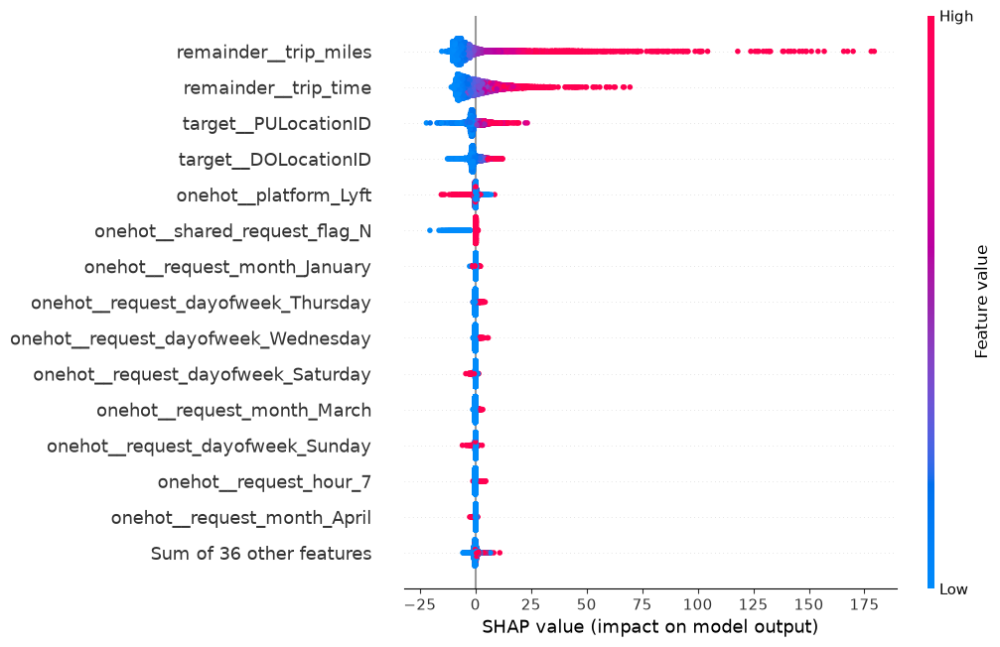
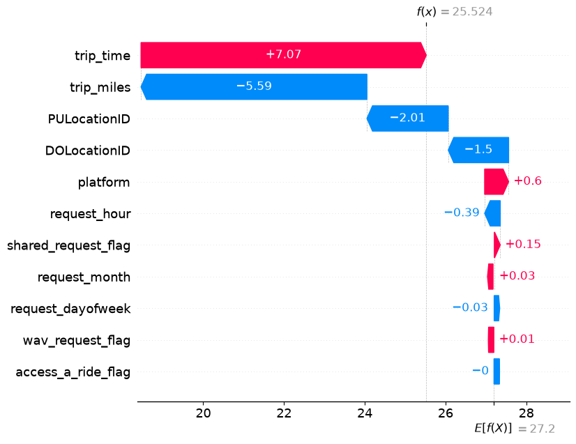

# NYC Ride-Hailing Fare Prediction and Explainable Decision Support

**An interactive machine learning prototype for estimating base passenger fares for Uber and Lyft trips in New York City (NYC).**

**Live application:** https://nyc-fare-prediction.streamlit.app/

Developed by Emmanuel Kwame Okyere as part of an MSc Business Analytics (Financial Analytics) research project at the University of Ghana Business School.

## Project overview

Ride-hailing fares depend on trip characteristics such as distance, duration, location, and time. This project compares regression models for passenger fare prediction and integrates the selected LightGBM model with SHAP explanations in an interactive Streamlit decision-support application.

The intended users are pricing analysts and business decision-makers. The application allows them to examine an estimated fare and explore how changing trip characteristics affects model predictions. It is a **research prototype**, not an official Uber or Lyft fare quotation system.

## Data and prediction target

- **Source:** Public NYC Taxi and Limousine Commission (NYC TLC) High-Volume For-Hire Vehicle (HVFHV) trip records.
- **Period:** January-May 2026.
- **Platforms:** Uber and Lyft.
- **Target:** `base_passenger_fare`, measured in USD. This is not the same as the complete amount ultimately paid by a passenger.
- **Predictors used in the application:** trip distance (`trip_miles`), duration (`trip_time`), request month, request day of week, request hour, platform, pickup and drop-off Taxi Zone IDs, shared-ride request, wheelchair-accessible vehicle request, and Access-A-Ride flag.

### Dataset size and training/test split

The January-May 2026 source files contained **105,996,114 trip records**. After data cleaning, **105,932,184 records** were retained for analysis.

The cleaned dataset was split once into a training pool and a held-out test set (80/20 split, `random_state=42`):

| Dataset portion | Records | Purpose |
| --- | ---: | --- |
| Full cleaned dataset | **105,932,184** | Source for modelling |
| Training pool (80%) | **84,745,747** | Source for fitting and training samples |
| Held-out test set (20%) | **21,186,437** | Shared evaluation set for all models |

**Important:** The 21,186,437 records were the **test set**, not the training size of every model. Linear Regression was fitted on the full training pool of 84,745,747 records. To manage computational requirements, the ensemble models were fitted on smaller samples taken from the training pool: 5 million records for Random Forest, XGBoost, and CatBoost; 5 million for the LightGBM sensitivity comparison; and 7 million for the final LightGBM model. **All reported test metrics were calculated on the same 21,186,437 held-out records.**

The project involves data cleaning, exploratory analysis, feature engineering, model comparison, and interpretability. The fitted pipeline applies preprocessing to inputs before passing them to the LightGBM model. In the research modelling workflow, lower-cardinality categorical features are one-hot encoded, pickup and drop-off Taxi Zone IDs are target encoded, and distance and duration are retained as numerical features.

The large raw trip-record dataset and model-training notebooks are **not included** in this repository. The application and its saved inference pipeline are provided here.

## Models and evaluation

Five regression model families were evaluated on the same held-out test set of **21,186,437 records**. Root Mean Squared Error (RMSE) was the main model-selection metric, supported by Mean Absolute Error (MAE) and R-squared (R²). The table includes an additional LightGBM result at 5 million training records to show the comparison with other ensemble models at a common sample size.

| Model | Training records | Test RMSE (USD) | Test MAE (USD) | Test R² |
| --- | ---: | ---: | ---: | ---: |
| **LightGBM (final model)** | **7,000,000** | **9.80** | **5.25** | **0.8506** |
| LightGBM (5-million comparison) | 5,000,000 | 9.83 | 5.26 | 0.8496 |
| Random Forest | 5,000,000 | 9.93 | 5.40 | 0.8467 |
| XGBoost | 5,000,000 | 9.93 | 5.30 | 0.8467 |
| CatBoost | 5,000,000 | 10.05 | 5.37 | 0.8430 |
| Linear Regression | 84,745,747 | 10.61 | 6.13 | 0.8248 |

**Why 7 million training records?** At the common training size of 5 million records, LightGBM already had a lower test RMSE (USD 9.8333) than Random Forest (USD 9.9261) and XGBoost (USD 9.9277). Increasing the LightGBM training size to 7 million further reduced test RMSE to USD 9.8007, reduced MAE from USD 5.2565 to USD 5.2535, and increased R² from 0.8496 to 0.8506. The improvement was modest, but the 7-million-record version was retained as the final model for the interactive prototype.

The additional 5-million LightGBM row is the common-size sensitivity comparison reported in Table 4.12 of the research, while the 7-million result is the selected final model reported in Table 4.15. The table therefore shows **five model families and six evaluated configurations**, not six different algorithms. Training sample sizes differed because of computational constraints.

These metrics describe the historical held-out test set. They do not guarantee accuracy for future periods or markets.

## Explainability with SHAP

SHapley Additive exPlanations (SHAP) were used to explain the selected LightGBM model. The two figures below are original outputs from the research notebook, using held-out trip data.

### Global explanation - SHAP beeswarm



*Each dot represents a trip in the SHAP sample. Its horizontal position shows how a feature contributes to the predicted fare, while colour indicates low (blue) or high (red) feature values. Trip distance and duration show the strongest overall effects; higher values generally push fare estimates upwards. The plotted names reflect the model's transformed inputs.*

### Local explanation - SHAP waterfall



*For one held-out trip, the model estimates a base passenger fare of USD 25.52 (actual fare USD 26.08), compared with a SHAP baseline of approximately USD 27.20. Trip duration increases the estimate by about USD 7.07, while trip distance reduces it by about USD 5.59. Pickup and drop-off locations also reduce the estimate. The waterfall groups model contributions back to the original predictors.*

**Interpretation:** SHAP describes predictive contributions relative to the model baseline. These plots do not establish causal effects or reproduce the ride-hailing platforms' internal pricing algorithms.

## Streamlit application

**Step 1 - Enter trip details.** Choose a request date/time (within the study period), Uber or Lyft, pickup/drop-off boroughs and Taxi Zones, distance, duration, and service-request flags.

**Step 2 - Review the result.** The app displays the estimated **base passenger fare in USD**, a trip summary, a SHAP waterfall explanation, and a table of feature contributions. The SHAP chart can be downloaded as a PNG.

**Explore scenarios.** Use **Modify Trip Inputs** to change trip characteristics and generate another estimate. These are manual scenarios, not live platform quotations.

## Repository contents

| File | Purpose |
| --- | --- |
| `fare_prediction_app.py` | Two-page Streamlit interface, inference, and SHAP explanation |
| `lgb_final_model_7m.joblib` | Saved LightGBM inference pipeline, including preprocessing |
| `taxi_zone_lookup_streamlit_final.csv` | Taxi Zone names and supported pickup/drop-off selections |
| `requirements.txt` | Python packages needed by the application |
| `README.md` | Project documentation |

## Run the application locally

Install a compatible Python environment, then run:

```bash
git clone https://github.com/ek-okyere/nyc-fare-prediction.git
cd nyc-fare-prediction
python -m venv .venv
```

Activate the virtual environment for your operating system, then:

```bash
python -m pip install -r requirements.txt
streamlit run fare_prediction_app.py
```

The application loads the serialized model and Taxi Zone lookup from the repository folder. Only load `.joblib` files from sources you trust. The local installation steps are provided for reproducibility; execution may depend on package and Python-version compatibility.

## Scope and limitations

- The model was developed using NYC TLC HVFHV data from January-May 2026, and the application date input is restricted to that period.
- Trip inputs are entered manually; the prototype is not connected to Uber, Lyft, live route services, or live pricing APIs.
- Predictions are estimates of `base_passenger_fare`, not binding quotes or guaranteed final passenger charges.
- Model explanations describe predictive associations, not causal effects.
- This repository contains the demonstration app and saved inference pipeline, rather than the full large-scale training workflow.
- Additional temporal validation, operational monitoring, and further testing would be needed before any production use.

## Technology

Python · pandas · NumPy · scikit-learn · LightGBM · SHAP · Streamlit · Matplotlib · joblib

## Author

**Emmanuel Kwame Okyere**  
MSc Business Analytics (Financial Analytics), University of Ghana Business School  
[LinkedIn](https://www.linkedin.com/in/ekokyere)
